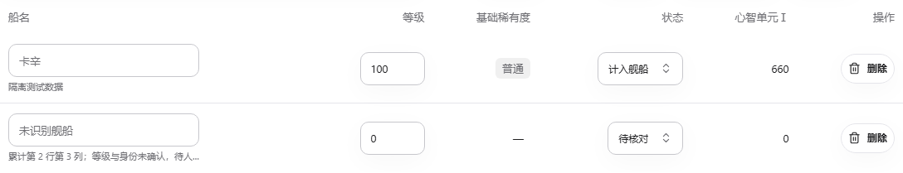
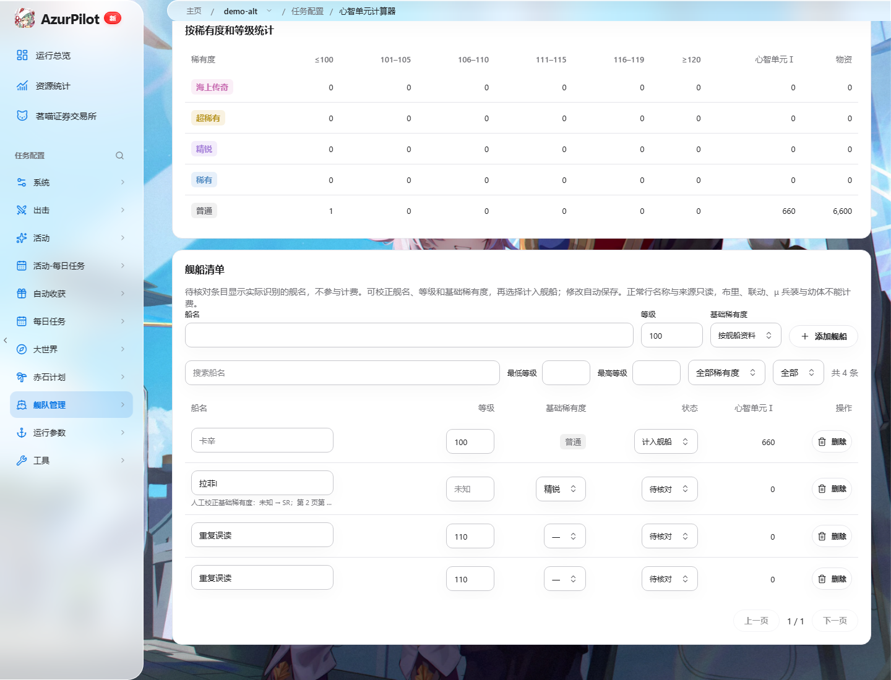

# 心智单元计算器

> 在 AP 内扫描船坞、核对舰船清单，并计算升至 120 级所需的心智单元Ⅰ与物资。

## 1. 模块概述

实例的「舰队管理 → 心智单元计算器」打开 `/i/:instance/task/MindCalculator`，与「舰队信息」并列。
旧 `/i/:instance/mind-calculator` 链接自动跳转到新入口；侧栏树、桌面悬浮菜单和顶栏任务跳转共用 WebUI 导航项，计算器不注册为可执行游戏任务。
用户可以手工录入、导入 JSON / CSV / Excel、导入船坞截图，或运行 `MindCalculatorScan` 自动任务。
名单身份、等级与基础稀有度均确认的舰船直接纳入计算；不确定的结果保留待核对状态。
布里、联动舰船可识别并保存，但归入已排除，不产生心智费用。

实现参考心智单元计算器 v0.32.43 还原工程的 `Calculator.cs`、`OcrService.cs` 和 `AutoScanService.cs`，
在 Python / React 中独立实现，并复用 AP 的设备、OCR、船坞导航和任务恢复机制。
公共舰船资料直接复用 `assets/ship/ship_data.json`，由现有 Lua 提取器维护，不再保存独立的计算器目录。

## 2. 模块职责

### 负责

- 按实例保存舰船清单、核对状态、排除状态与数据版本。
- 定位船坞卡片，重读船名及等级，按跨屏位置合并卡片。
- 按基础稀有度计算剩余觉醒材料，按基础舰船身份取最高等级。
- 提供五种界面语言、待核对舰名校正、等级与状态编辑、单条删除、组合筛选分页及文件导入导出。

### 不负责

不执行觉醒、强化或退役，不推算升级经验，不统计 120→125 级的心智单元Ⅱ。
不调用原 WPF / WebView2 程序，不接入原工具的云 OCR 或同步账号。

## 3. 模块位置

| 位置 | 职责 |
| --- | --- |
| `module/runtime/mind_calculator.py` | 舰船资料、身份归并、费用计算 |
| `module/runtime/mind_recognition.py` | 卡片定位、多轮 OCR、跨页合并 |
| `module/retire/mind_scan.py` | 自动船坞扫描任务 |
| `module/api/mind_calculator_service.py` | 实例保存、导入、识别与导出 |
| `assets/ship/ship_data.json` | 共享舰船属性、基础身份与改造名称 |
| `frontend/src/pages/MindCalculator.tsx` | 页面、草稿、核对和任务入口 |
| `frontend/src/mind/` | 类型、翻译和布局 |

## 4. 核心入口

| 入口 | 用途 |
| --- | --- |
| `alas.py::mind_calculator_scan()` | 调度任务派发 |
| `MindCalculatorScan.run()` | 重置筛选、回顶、扫描和保存 |
| `recognize_cards()` | 截图归一化后识别三行，返回位置、等级可靠性和可编辑字段 |
| `calculate()` | 无设备依赖的费用计算 |
| `mind.report / mind.calculate / mind.catalog` | 已保存结果、草稿预览和公共资料 |
| `mind.save / mind.import / mind.recognize / mind.export` | 保存、文件互通、截图识别和导出 |

## 5. 核心组件

`Card` 包含列、屏幕坐标、可编辑舰船字段及识别质量。
`ScanMerger` 从相邻截图的重叠区域核验正负滚动距离，映射绝对行坐标后按位置选择较好的读数。
中间截图仅通过 `advance()` 累计位移；两次整页 OCR 相隔三排时，不要求这两张截图直接重叠。
位移比较先抽取既有采样列，再转为连续浮点数组；逐像素误差、全部候选位移与歧义拒绝阈值保持一致。
内部保留各船位核验排序和重叠；输出清单与批量截图导入按基础身份取最高等级，后遇到更高等级替换整条记录。
改造前后属于同一身份，等级相同时优先保留改造条目；II 型及 META 保留独立身份，不去掉 II 后缀。
陌生名字不推测改造关系，占位名称不合并。

目录以图鉴群组保留同名舰，原始读数使用 `raw_name`，人工选择使用带舰种或阵营的完整名称。
天城分为「天城（战巡）」「天城（正航）」，加贺分为「加贺（战列）」「加贺（正航）」；
自动识别必须有至少两次名称读数及飞机/炮舰字形的正向证据，不能凭稀有度或未命中某种图标选择。
约克（皇家/铁血）、新月（皇家/重樱）属于同名同舰种，默认单独保留待核对卡位；
可见且唯一的实际改造名仍可确认原群组。人工选择限定名称后仍待核对，明确选择计入后才计费。
同群组原舰与改造取最高等级，不同群组分别计费；新月皇家按基础普通稀有度计费，重樱按精锐计费。
旧记录中未限定身份的同名项仅在读取时显示待核对，不自动改名、猜阵营或改写历史与人工记录。
名称与人工确认的浏览器示例见 [同名群组清单](../../images/mind-scan-identity/same-name-groups.png)（模拟数据，非账号验收）。

舰船字段为 `name / level / rarity / base_rarity / excluded / review / source`。
等级未确认以 `level=0, review=true` 保留，界面显示“未知”；0 只表示未知，不是正常舰船等级，不参与计费。
待核对卡位分别保留，不按未确认的同名身份合并，也不覆盖已确认条目。`source` 保留卡位、原因和异常原帧路径。
`revision` 是保存的舰船数组的 SHA-256，用来拒绝过期覆盖。

## 6. 工作流程

手工录入或文件导入 → 草稿计算 → 保存 → 导出。新增时默认使用资料稀有度，也可显式指定基础稀有度。
正常清单的名称、基础稀有度和来源只读；待核对行显示实际 OCR 读数，可从资料选择完整舰名，也可手动修改基础稀有度。
等级在失焦或回车提交有效整数（1–125）后自动计算并保存。校正名称、等级或基础稀有度仍保持待核对，人工选择计入舰船后才计费。
状态可切换为计入舰船、待核对或已排除，分别更新持久字段 `excluded / review`；删除按钮只移除对应原始行。
待核对舰名、等级、基础稀有度、状态与删除复用防抖计算及自动保存，保存期间禁止重复操作，保留当前分页并限制到有效页码。
名称、等级范围（包含上下边界）、基础稀有度及状态可以联合筛选，只影响展示，不改变总额、扫描范围或保存清单。
布里、联动、μ 兵装和幼体的自动排除状态不可切回计费；缺少有效等级或基础稀有度不能通过切换状态计费。
同名合并仍由最高等级及同级优先改造规则派生，不能手动指定；排除或删除其中一行后重新计算其余有效行。
无效等级回到原值；保存失败保留草稿和具体错误，版本冲突不自动覆盖或循环重试。
提交后切换实例，成功响应仍清除本次对应的旧草稿；不会清除后来编辑的新草稿。

自动任务：导航至 `page_dock` → 重置筛选并确认等级降序 → 滚动条回顶并确认 → 持续截图等待画面稳定 →
识别三行卡片 → 核验跨屏位移并合并 → 确认范围结束或实际到底 → 比较旧数据版本 → 保存结果。
任务不使用固定休眠判断游戏界面是否就绪。

识别优先复用 `DockScanner` 的行间空白判定与 `CARD_GRIDS` 七列网格，定位包含完整等级和船名的三行；
稀有度色带与整屏 `Lv` 锚点仅作补充。滚动停位未对齐时不读取被裁掉等级或船名的行，翻页按实测位移核验完整三行，允许行在可见区域内少量偏移。
短距离拖动补偿游戏的滑动激活距离，随后必须通过截图确认真实位移，不把触控距离当作滚动距离。
末页不要求继续对齐三排行距。严格滑块距轨道末端仅两行时，只有这两行存在逐行收窄、
与严格颜色八邻接且延伸到轨道终点的圆角颜色证据，才补充证明到底；不扩张用于位移标定的滑块读数。
此时仅读取完整可见的末排，顶部裁掉等级的旧行不重读、不补成未知舰船；近底部、静止或端帽遮挡仍不能结束。
逐卡裁剪船名条与等级条，直接调用 `FleetNameScanner.NameOcr.pre_process()`，复用其 19 像素文字行裁剪、白字、婚舰粉字及边缘去噪；未匹配名称再用相同文字行的原色和放大字图重读。
等级先以实机 Lv 灰度模板定位数字区域和位数，再复用 `StorageAmountGlyphs` 的严格原生字形比较。
船坞使用独立字形资源，不改共享识别器；模板不能确认时，使用现有 `AlOcr` 对原色、白字与放大图交叉核对。
同位数候选至少两次一致且无冲突才接受，不猜补百位。模板来源和再生成见 `assets/ship/dock_level_templates.md`。
船名优先匹配国服 `ship_names.json` 与计算器目录，接受精确命中、实机核实过的形近字修正或唯一的省略号截断补全；
有 II 型的基础舰名还需复读后缀。基础型和 II 型同时出现时，至少两次读到 II 且基础型只出现一次才采用 II，否则保留异常提示。
精确匹配与有界复读仍未确认时，调用 `mind_name.match_lua_name()` 对照 Lua 生成的国服完整目录 `ship_data.json`。
相似度采用规范化文字的序列匹配；四字以上的读数或图像/文字省略号允许按可见长度比较长名前缀，
同时处理前缀中的形近字，避免缺失尾部把有效读数误判为低分。多轮至少两次支持同一候选，
匹配分低于 0.55 才因文字不足进入核对；分数是字面匹配指标，不是识别正确率。
相近候选（与最高分相差不超过 0.05）可由卡框稀有度、橙色 META 外沿及航空图标的正向证据区分。
卡框与图标仅筛选完整目录身份，基础稀有度和排除分类仍取 Lua 资料；飞机字形由正航、轻航、航战、潜母共用，不能细分。
目录改造别名沿用基础舰种时，不据战列基础舰种排除改造后的航战。META 外沿与普通舰精确命中冲突时也需复读，
避免“伊丽莎白女王·…”等截断名前缀绕过身份核验。
例如共用“安德烈亚·多利…”前缀的普通舰/META 分别由紫框/橙色 META 外沿确认；
“小天凤”近似小天城、小大凤和小天鹅，紫框与航母图标共同确认小大凤，仍按幼体自动排除。
多轮明确身份冲突、未确认的 II/META 后缀或同分候选缺少区分证据仍须核对，不能用字面分数消除身份冲突。
有卡头或等级证据但名字未读出的卡片保留实际 OCR 文字；完全没有有效文字时使用位置占位名称，要求人工修正。
名称右端有同基线、独立且紧邻正文的双点时，可补充 OCR 漏读的省略号；短名右侧大块空白中的卡面亮点不能证明截断。精确路径先按唯一前缀补全，歧义交给上述目录匹配与图像证据。
实机核实的“自凤→白凤”使用明确字面校正，名称两侧的引号和顿号残影不参与匹配，中间字符及 II/META 后缀保留。
正常来源提示记录已确认的名单身份；原始 OCR 候选与图像省略号证据保存在卡位诊断 JSON 中，避免复读路径或标点改变正常来源。
短名仍无法确认时，在同一原色文字行去掉两侧各六像素的卡框残影，再以两张字图复读；两次必须分别精确确认同一身份。
单字名失败时，使用共享黑白字图，在下移 0/2/4 像素、两侧各去 4/8 像素的有限组合中平滑放大双读；至少一个组合的两种尺度均须精确确认同一身份，各组合不能出现其他身份。只有分散的单次命中仍保留待核对。
长名、截断名和 II 家族不走这条去边路径；复读失败后共用上述 Lua 名单补全，不改舰队扫描器及人工输入的严格身份查询。

默认仅录入 95–125 级，边界均包含。置顶编队与普通舰分别核对等级降序，
仅当前完整三行的全部普通舰等级可靠且低于下限时允许提前结束；异常等级、缺卡或排序冲突不触发早停。
编队归属复用 `FleetScanner` 数字模板；数字未确认时仅以“编队”文字模板补充未知状态，不能把蓝卡背景当作编队。
绿通道未匹配编号时补读 RGB 三通道均满足阈值的白色字形，仍使用原编号模板及相似度，避免透明徽标与立绘混色造成假普通舰。
编号比较全部模板的得分，最高分须达到原门槛且领先次高分至少 0.05；两种字图出现编号冲突或相近候选时保留未知状态，获取新帧复核。
单卡名称、等级不能确认时重新获取稳定截图，最多三次；仍失败则保留该卡位为待核对并继续扫描。
三帧后身份仍未确认时保留实际 OCR 读数，供人工判断大致方向；名称可读不表示身份已确认。待核对标记使同名卡位分别保留且不计费，累计行列、复读候选和原帧仍保留。
待核对卡位不按候选读数丢弃，包括候选等级在范围外的核对项；身份和等级已确认的范围外条目仍不导入。
编队标记未确认或新页与累计两段排序冲突时，也在合并前有界重读，候选检查不改变已确认排序状态。
首次编队/排序异常保留原帧供诊断；三次仍失败则标记冲突涉及的卡位待核对，不猜哪一侧读错。
每页复核本页及前一船位边界。等级、编队或排序疑点只作用于原卡位与必要的交界两侧，保留待核对记录；
最后一个疑点之后出现完整可靠、等级降序且低于下限的普通舰页面时，可以恢复早停，不强制整段扫描到底。
当前页仍有疑点、缺格、编队或未越过下限时不允许早停；重叠页以物理卡位确认当前窗口，不以不同帧的对象身份判定。
核对项用累计网格行号记录位置，避免合法停位的像素差异改变同一卡位的提示；记录最终接受的原帧。
跨页冲突涉及上一页卡位时另存上一页原帧，避免把前页卡位指向不包含它的新帧。
诊断图位于当前日志目录下的 `mind_scan/<实例>/`，写盘失败只记录警告，仍继续新帧复核。
每次完整扫描事务保存成功后，只保留本轮该实例的诊断图与 JSON，清理上一轮生成文件；停止、异常或版本冲突不清理旧清单引用的原帧。
离线复现或已授权实机诊断可临时创建 `cache/mind-scan-diagnostics`，保留全部接受页的原帧与卡位 JSON；
此标记不改变识别、排序、位移或保存规则，并暂停旧图清理以保留验收证据，诊断结束后移除。启用时的写图耗时不代表默认运行性能。
末页可能与前页重叠，仍按原合并器和滚动条端点处理，不把重复行当作排序反例。
底部不足三行时识别实际卡片；按滚动条真实像素端点确认底部，不使用通用控件的百分比容差提前结束。
扫描器仅在一个阈值边界行内补抗锯齿像素，以前后严格颜色核验二维八邻接连接，首尾端点保持原值，不修改通用滚动条阈值。
暂时看不到可靠滑块时，仍可依据独立唯一的卡片位移继续范围扫描，但该帧不能证明到底。
重复卡片的候选可以结合滑块双端同向运动、支持按住结束的单次手势边界及此前明确位移的比例校准筛选，仍要求唯一图像证据；
拖动后的重复画面不能因看起来相同就认定零位移，当前步最多三次新帧复核。无证据、页面丢失或设备/模型异常继续保留旧清单。
按住结束的小距离校正若幅度小于半排行距，可在包含零和反向候选的对称界限内核验唯一图像匹配，不依赖滑块的亚像素移动，也不猜实际拖动量。
局部缺格在当前页最多三次重读后，只有可靠行位与同排实际卡片证据齐全才保留未知卡位继续；整个页面不可读时不捏造占位舰船。
当前只读取船坞卡片的舰名和等级，不进入舰船详情页，也不读取经验。

## 7. 调用关系

### 上游

React 页面经 `/api/v1/ws` 请求 API；手动工具任务经运行时调用 `alas` 方法。

### 下游

使用 `Dock` 导航、筛选、降序切换及 `DOCK_SCROLL`，使用设备现有截图与拖拽能力。
扫描任务直接核验滚动条像素端点，不修改舰队管理共用的滚动条或扫描器。
使用 `AlOcr` 的 PP-OCRv6、等级识别接口和现有 OCR 工作队列，不另建模型下载系统。
Excel 由锁定的 `openpyxl` 依赖读写。

## 8. 数据流

截图 → 内存卡片与位移 → 可编辑舰船数组 → 实例配置 → 费用报表 → 浏览器或导出文件。
置顶编队页和局部复核页保留原帧及最终卡位 JSON，普通正常页不写图；不保存 OCR 模型或设备配置。
已知舰船的基础稀有度默认使用资料；手工新增或清单导入明确指定的基础稀有度保留到保存、重载与导出。
截图识别不以卡框猜测改造基础稀有度；缺少可靠资料时保留核对状态。

## 9. 状态模型

每行计算状态为 `included / merged / review / excluded`，额外返回只读的 `automatic_excluded` 标记；自动排除条目不能切换为计费。
`automatic_excluded`、状态、费用及资料补全字段均不写入清单，保存仍只使用上述七个持久字段。
手工排除优先于核对；自动排除舰船若存在未确认读数仍显示待核对，核实后可选择排除，始终不能计费。
待核对、未读到等级或缺少基础稀有度时不计费。
同基础身份只保留有效清单中最高等级的一行，其余行标为合并。
META 保留独立身份；共享资料 `nationality=98` 的三种布里（泛用型、试作型 MKII、特装型 MKIII）、联动、μ兵装与幼体舰船自动排除，仍可在排除筛选中查看。布里分类只在计算器目录构建时派生，不改共享资料或舰队识别器。

## 10. 配置

`MindCalculatorScan.MindCalculator.Result` 是隐藏的 `stored` 配置，默认 `{}`，
内容为 `ships` 和 `updated_at`。仅保存本实例数据，配置生成器维护对应模板与类型。
`MindCalculatorScan.MindCalculator.MinLevel / MaxLevel` 默认 95 / 125，可设 1–125 且下限不大于上限。
计算器页面经 `config.patch` 保存范围后才调用 `tasks.run`；国服实例标识兼容 `cn` 与 `cn_android-*` 等 `cn_` 前缀。
自动任务使用实例现有 OCR 配置；上传截图接口使用默认 ONNX / CPU 设置，不读取私人云配置。
两条路径创建的 `AlOcr` 均设置 `save_debug_images=False`，避免每张字图写盘及整理目录。
此选项属于识别器实例，不参与模型缓存；其他任务沿用原来的调试图默认行为。
等级重读、身份冲突提示及任务异常截图保留。离线诊断可向 `recognize_cards()` 显式传入
`AlOcr(..., save_debug_images=True)`，不需要修改全局模型或用户配置。
稳定画面比较使用原有完整灰度签名的平均绝对差，阈值仍为大于 1；由 OpenCV 直接处理字节数组，
避免整帧浮点临时分配，不减少截图、比较像素或稳定等待条件。

## 11. 异常与错误处理

输入文件、分辨率或字段错误返回 `INVALID_PARAMS`；旧版本保存返回 `CONFLICT`。
上传允许 PNG / JPEG / WebP，处理 EXIF 方向、可确认的成对黑边及完整 16:9 游戏区域，复用设备截图缩放到 1280×720。
非船坞、全黑、不完整比例、损坏文件和超限图片分别返回原因，OCR 引擎失败返回 `OCR_UNAVAILABLE`。
批量上传按文件显示进度；坏文件提示文件名和原因，已成功识别的文件仍进入草稿。
船坞无法回顶、卡片无法定位、相邻截图无法对齐或三排定位不确定时抛出 `MindCalculatorScanError`，要求人工接管，旧结果保持可用。
任务运行器记录具体原因、完整异常与错误截图，结束本次工具任务并保留旧清单；识别失败不触发模拟器重启。
画面长时间不再滚动或达到页数上限但未确认到底时抛出 `GameStuckError`，沿用上层恢复。
稳定等待或页面丢失超过 30 秒抛出 `MindCalculatorScanError`；期限检查覆盖动画、等待与弹窗分支。
已核实新页并新增物理船位后重新计量滚动期限，避免把有界 OCR 复读的耗时算作下一段滚动停滞；重复旧船位不能续期，零位移与缺页保护仍有效。
无进展检查位于循环前部；定位仍限制最多八次拖动，卡位数与页数保留原有上限，不能以触控距离或缺卡证明到底。
局部识别错误作为核对项随完整扫描一次保存。用户停止、设备或模型异常、布局/位移无法确认仍不提交半份结果，保留旧清单。
识别器初始化或逐页扫描发生 `MemoryError` 时，转为 `MindCalculatorScanError`，报告内存不足并保留旧清单，
避免将主机内存不足当作游戏故障进入通用重启恢复。

## 12. 并发与线程模型

API 业务沿用 WebSocket 工作线程，OCR 沿用现有队列。
API 保存和游戏工作进程共用实例配置事务锁，锁内重读并比较舰船版本。
扫描途中用户保存不同舰船数据时，任务拒绝覆盖并提示重新扫描。

## 13. 缓存与持久化

公共资料按进程缓存；文件更新后重启服务加载。
舰船清单原子写入实例配置；原工具私人配置和用户下载路径不会进入内置资源。
前端将未保存草稿与原版本存入按实例区分的 `sessionStorage`，重载或导航后可恢复。
恢复的过期草稿仍受保存版本校验；重新载入会明确丢弃草稿。

## 14. 生命周期

计算器页面加载公共资料与本实例清单，编辑后防抖计算，每五秒读取保存结果。
有未保存草稿时轮询不覆盖编辑。实例路由切换重新挂载页面，响应不会写入其他实例。
编辑或删除后的报表必须与对应输入快照匹配，不能在新清单索引上显示旧行的状态或费用。
自动任务仅在用户启动时连接设备，确认完成后一次保存，停止操作复用任务运行器。
扫描页数、累计读取船位数和同名归并后的范围内数量记录到 `[心智扫描]` 日志，页面读取任务日志显示进度。

「自动扫描船坞」要求连接可用、数据已加载、草稿已保存，且当前实例没有任务运行或更新。
禁用时按钮下方直接显示当前阻塞原因，扫描期间提供「停止扫描」。
游戏地区使用实例列表中的 `region`，由后端按 `Emulator.PackageName` 和现有 `to_server()` 规则解析。
`Emulator.ServerName` 是可关闭的开服检测配置，不能用来判断是否国服。
包名为 `auto` 时地区暂为 `null`，允许启动，由设备检测实际包名后执行任务中的国服校验。

## 15. 扩展方式

更新资料运行 `uv run python -m dev_tools.ship_data_extractor --lua-repo <Lua 仓库路径>`，
统一生成 `assets/ship/ship_data.json`。改造名称从 `skin_type=2` 的皮肤表提取，写入基础舰船的 `retrofit_names`。
计算器运行时按名称合并突破阶段，排除无舰船模板及复制身份的剧情记录；改造关系保留基础稀有度，II 型与 META 保持独立身份。
幼体分类由 Lua 的 `Little-series` 标签生成 `is_child`，不按「小」字前缀判断，避免排除小猎兔犬与小天鹅。
目录没有独立更新时间，接口的 `updated_at` 返回空字符串；更新共享文件后重启服务加载。
共享资料只有剧情记录、缺少可获取身份的舰船保留待核对，不使用剧情模板自动计费。
支持其他游戏服务器前，应增加对应语言舰船资料与截图回归；不能只解除国服检查。
调整 API 参数时重新生成契约；调整配置源时重新运行配置生成器并补齐五语言文案。

## 16. 修改注意事项

费用阶梯按已越过的觉醒门槛推断：≤100 未越过，101–105 越过一次，106–110 两次，111–115 三次，116 起四次。
等级停在 100、105、110、115 时可能已经觉醒，但截图不能证明，按该等级尚未越过门槛计算。
四阶心智费用为 N `60/120/180/300`、R `80/160/240/400`、SR `120/240/360/600`、
SSR `200/400/600/1000`、UR `300/600/900/1500`；物资为心智费用的十倍。
改造按基础稀有度，不以画面升档后的卡框直接计费。

上传原文件限制 5.5 MB，舰船最多 5000 行，Excel 解压内容最多 32 MiB。
WebSocket 仅计算器文件及清单方法允许扩展到 8 MiB，其他业务仍保持 1 MiB。
`gui.py` 的 Uvicorn 帧上限必须同步为 8 MiB，否则 Base64 图片会在进入 API 前被 1009 断开；mock 服务使用相同限制。
Excel 文本不执行公式；CSV 导出对公式起始字符加文本前缀。

## 17. 已知限制

自动扫描目前支持国服标准船坞，设备沿用 AP 的 1280×720 识别坐标。手动截图支持完整 16:9 画面的等比缩放和成对纯黑边，
不自动识别任意桌面窗口边框或被裁掉的游戏内容；七列位置沿用 AP 标定。
原工具自动采集按 2560×1440 标定，不能直接复用原尺寸参数。
这是原生迁移，未复刻原工具全部特例：无云 OCR、舰种图标判别、原 Excel 截图缩略图和全套多种位移种子选优。
截图批量导入和自动扫描均对同名取最高等级；自动扫描额外核验跨屏位置和排序。
可靠结果直接计算；单字舰名、低清晰度图片与多轮读数冲突仍需核实，不确定结果不计费。
待核对行可从资料选择舰名，也可修改基础稀有度；正常行身份只读。状态切换代表人工明确核对，校正名称、等级或基础稀有度不会自动清除核对标记。个别截图通过不代表所有实例的全名单准确率。

## 18. 示例

清单控件修改前（用户提供的需求截图）：

修改后（隔离浏览器测试数据，展示等级/稀有度筛选、状态选择与单条删除）：

未知等级清单的页面对照：基线显示 0 且名称只读；恢复后显示“未知”，待核对名称可校正，基础稀有度可手动选择。恢复后的示例演示已将未知条目基础稀有度设为精锐，仍保持待核对且不计费。

拉菲 100 与拉菲.改 106 合并后按 106 级、基础 SR 计费，剩余 `360 + 600 = 960` 心智单元Ⅰ。
125 级不再产生目标 120 级的费用。等级未读到或仍待核对时显示核对状态，不计入总额。
JSON 为带 `ships` 数组的对象或数组；CSV / Excel 按“船名”和“等级”表头定位。
原工具 Excel 的明细第二行表头、存疑状态和右侧排除船名区均可回读。

## 19. 调试方法

运行 `uv run python -m unittest tests.test_mind_calculator tests.test_mind_scan tests.test_fleet_ship_names tests.test_fleet_emotion`。
离线夹具覆盖真实船名、META、截断名、等级与核对状态；模拟图覆盖漏百位、跨屏合并和无重叠拒绝。
三行夹具覆盖编队置顶、范围边界、同名多艘、缩放与黑边；传输回归使用真实 Uvicorn，覆盖大图片上传与普通请求限额。
模拟图另覆盖第三排、灰色卡面误判、三排累计位移、动画停稳、反向过冲校正、末页及无重叠拒绝。
独立实机等级裁剪保留未参与模板提取的验证页。
`mind_names.png / json` 仅保留实机名称条与人工标签，覆盖 II 后缀和形近字，并校验与舰队扫描预处理完全一致。
`mind_names_second_types.png / json` 保留约克城 II、列克星敦 II 以及实际失败原帧的北安普敦 II 名称条，
验证不平滑放大后的后缀与已核实的 `ⅡI` 误读；不把单个 I 直接改为 II。
首读和既有复读仍未确认原舰/II 型家族时，增加两张最近邻放大字图，沿用原投票和歧义拒绝规则；
不把单个 I 自动补成 II。自动扫描仍未确认时重新截图，最多读取三帧，仍失败标记该卡位待核对并继续。
`uv run python -m unittest tests.test_scheduler_recovery` 验证识别失败保留具体原因且不重启模拟器。
浏览器流程在 `frontend` 目录运行 `npx playwright test --config playwright.mind.config.ts`，
模拟服务使用 `dev_tools.mind_calculator_mock.py` 调用真实算法，不连接任何设备。
浏览器回归还覆盖开服检测关闭时启动扫描、草稿保存后解除禁用、扫描停止、地区与运行/更新状态提示，
以及等级/状态/删除自动保存、冲突保留草稿、正常身份只读、待核对名称校正、未知等级与重复核对项保存、组合筛选、分页、改造身份归并、II 型独立和布里/联动排除。
`mind-navigation.spec.ts` 验证舰队管理下两个并列入口、旧链接跳转及舰队信息扫描开关的启停、完成后刷新和其他任务/更新时禁用；开关只启动 `FleetScan` 工具，不写实例自启设置。
查看任务日志中的“扫描页”“识别卡片”“船坞位置”，并检查舰船来源中的重读提示。
“本页编队”保留各卡位的编号；“扫描核对原帧”及重读原因用于定位累计排序不能确认的首个位置。
“早停检查”说明拒绝提前结束的证据；底部退出记录滚动条像素端点。“心智扫描源码”记录实际模块路径及 SHA-256，
“本页识别摘要”包含完整舰船字段、编队与等级可靠性，便于连续扫描时及时发现差异。

合成纹理和 `ImmediateTimer` 控制流程测试不能代表实机截图、拖动或稳定等待时间；实机端到端速度需另行授权验收。
`uv run python -m unittest tests.test_mind_scan_stuck` 回放原帧瑞凤徽标与蓝卡反例，使用真实 `ScanPolicy`、
`ScanMerger`、真实 `Timer` 和虚拟单调时钟验证新帧纠错后早停、疑点保留后到底、持续动画、页面丢失、无位移与假底部。
`mind_fleet_six.png` 保留同一 Z20 编队徽标的两种实机采样相位，复现首个过线模板将 6 记为 1，并验证候选排序及歧义拒绝。
`mind_names_stuck.png / json` 保留两种实机采样相位的白凤与乌尔里希名称条，验证形近字、图像双点、唯一补全及无图像证据时的拒绝。
`mind_yorktown_phase.png` 保留约克城 II 被读成单个 I 的实机名称条；出现未确认罗马后缀时，
即使其他复读暂命中基础型，也补读名称区下移两像素后的两张字图。仍要求两次真实 II 读数，未确认后缀不能默认为基础型。
`mind_matsubream_phase.png` 保留松鲷被卡框残影干扰的两种采样相位，验证短名原色去边后的双读确认，不新增猜测名称映射。
`mind_shizuku_phase.png` 保留雫的实际失败字图，验证单字名缩边双读及冲突拒绝。
`mind_ryujo_phase.png` 回放龙骧的固定形近字误读；`mind_retrofit_punctuation.png` 回放华甲改造标点丢失，核验已确认的目录别名，同时拒绝普通/改造或其他舰船的冲突读数。
`mind_rarity_phase.png` 回放紫框同时满足 SR/R 颜色条件的实图；仅在卡框分类中剔除重复计数，原阈值及普通蓝框反例保持约束。
实机对照固定范围、资料和实际 OCR 后端，记录新工作进程与源码摘要，以扫描入口至「已保存」日志计时。
核对 API 与落盘清单时验证原始清单的 revision 和更新时间；报告行会补全资料、费用和状态，不能直接与原始清单字典比较。
多轮结果需核对全部清单、状态和费用，并保留来源提示的差异；轮询观察到停止的时间包含额外延迟。
本次复现、版本摘要、离线检查和实机验收见[修复验证记录](mind-scan-verification.md)。
Lua 名单相似度补全、META 前缀及航空图标区分的证据见[舰名补全验证](mind-lua-name-verification.md)。

## 20. 相关模块

[API](api.md)、[运行时](runtime.md)、[前端](frontend.md)、[OCR](../ocr.md)、
[退役与船坞](../game/retire-equipment.md)、[配置](../config.md)。

## 舰队科技的兼容导入

舰队管理下的[舰队科技列表](fleet-technology.md) 使用独立 `FleetTechScan` 任务，按群组保存身份，避免本计算器按基础舰名合并时丢失同名不同舰种。两个任务的等级范围、筛选和结果各自独立，心智计算规则不变。科技页面仍可主动导入本计算器的已确认清单，计费排除不阻止获得证据导入，歧义名称不猜群组。

旧版 `MindCalculatorScan.MindCalculator.FleetTechRecord` 只读兼容，首次科技编辑或扫描时复制到 `FleetTechScan.FleetTech.Record`，保留旧数据作为迁移备份。心智扫描或清单保存不再自动修改科技记录；新科技任务的记录、快捷等级切换及范围保护见对应文档。
